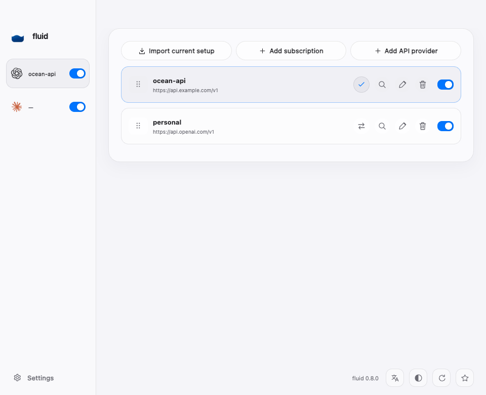
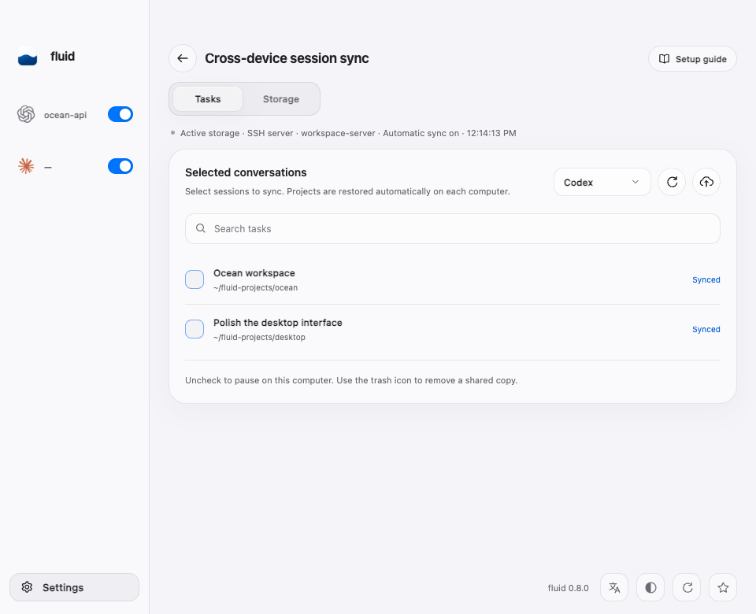

<div align="center">
  
  <h1>fluid</h1>
  <p><strong>Stay in flow. Let your tools move with you.</strong></p>
  <p>Provider routing · Sessions across devices · Usage you can understand</p>
  <p>
    <a href="https://github.com/JasperRoc/fluid/releases"></a>
    
    <a href="docs/LICENSE"></a>
  </p>
  <p>English · <a href="docs/README.zh-CN.md">简体中文</a></p>
</div>



### 🌊 One place for your AI connections

- **Route without restarting.** Switch Codex and Claude accounts or APIs; eligible failures try your next enabled provider before output starts.
- **Continue on another computer.** Select Codex or Claude Code sessions once. SSH or WebDAV carries encrypted history, Git state and uncommitted changes.
- **See where usage goes.** Request logs, tokens, cache hits and estimated API costs, grouped by provider and model.
- **Create images inside Codex.** Route image requests to a saved ChatGPT account, including Free accounts through the account-image adapter when their image access and quota permit.
- **Bring your extensions.** Manage Skills and MCP connections for Codex and Claude Code.

Rust powers the local gateway. TypeScript powers the interface and integrations. macOS and Windows use a tray app; Linux uses `fd` and a background service.

### 🚀 Get started

**macOS / Windows:** [download the installer](https://github.com/JasperRoc/fluid/releases), open fluid, then add a subscription or API. Start Codex or Claude normally. Use the tray icon to switch providers.

**Linux:** run as the user who runs Codex or the VS Code remote extension:

```bash
git clone https://github.com/JasperRoc/fluid.git
cd fluid
./install.sh
fd add api work
fd work
```

The installer uses your user directory and prepares a private runtime when needed. No global npm installation. API Base URL is optional; leave it blank for the client’s official API.

Upgrading an existing installation? Quit it normally first and keep a separate backup. This release uses fresh fluid application/data identities; see [release notes](docs/releases/0.8.0.md).

### ⌨️ A small CLI

| Action | Codex · default | Claude Code |
| --- | --- | --- |
| Switch | `fd <alias>` | `fd cc <alias>` |
| Add account | `fd add account <alias>` | `fd cc add account <alias>` |
| Add API | `fd add api <alias>` | `fd cc add api <alias>` |
| Edit | `fd edit <alias>` | `fd cc edit <alias>` |
| Remove | `fd rm <alias>` | `fd cc rm <alias>` |
| List | `fd ls` | `fd cc ls` |
| Reorder | `fd order` | `fd cc order` |

`order` opens a keyboard editor. `ls` shows priority and the selected provider. `fd update` updates; `fd uninstall` restores client settings and removes fluid; `fd help` shows help. Bash and Zsh completion are installed automatically. If you already use the file-search tool named `fd`, the installer asks you to resolve the name conflict rather than overwriting it.

### ✨ Make it yours

| Sessions that follow you | Usage at a glance |
| --- | --- |
|  |  |

[Desktop & routing](docs/desktop.md) · [Session sync](docs/task-sync.md) · [Skills & MCP](docs/extensions.md) · [Usage](docs/usage.md) · [Images](docs/account-images.md)

Screenshots use demonstration data.

### 📌 Know the boundaries

Provider changes apply to subsequent requests. Output already accepted is never replayed. Model availability, image permission and quota are enforced upstream; Free image support does not grant paid access. Usage cost is a reference estimate, not a bill. Current macOS previews need first-launch approval until Developer ID signing and Apple notarization are configured.

### ⚖️ Disclaimer

fluid is independent of OpenAI and Anthropic. Use credentials you are authorized to use. Routed conversation content is sent to the selected provider; review its privacy terms. Back up important work. [Full disclaimer](docs/DISCLAIMER.md).

### 🤝 Contribute

Found a rough edge? [Report it](https://github.com/JasperRoc/fluid/issues) or [send a focused improvement](CONTRIBUTING.md).

### 📄 License

[MIT](docs/LICENSE). Third-party notices are [here](docs/THIRD-PARTY-NOTICES.md).
