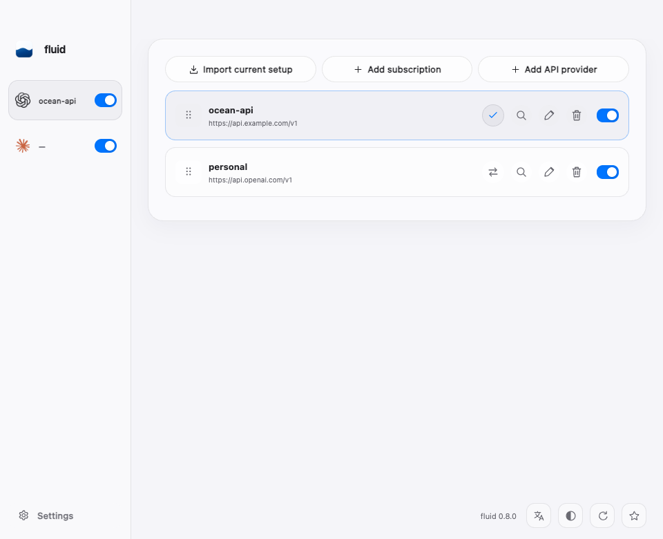
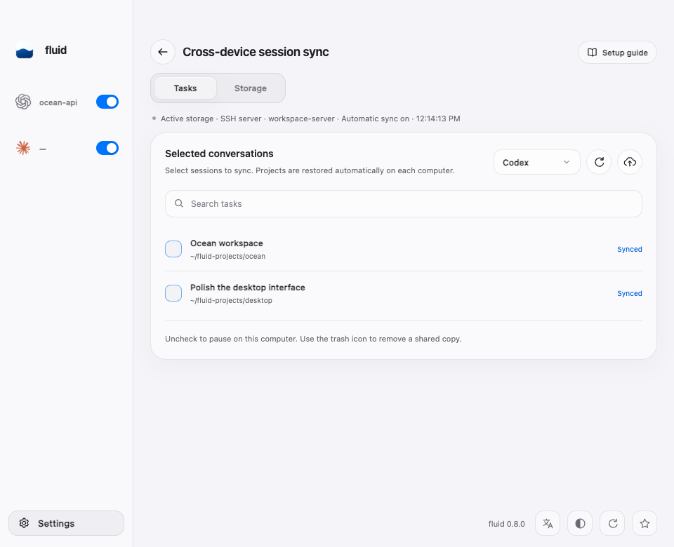

<div align="center">
  
  <h1>fluid</h1>
  <p><strong>让灵感流动，让工具随行。</strong></p>
  <p>简洁的服务商路由 · 跨设备会话同步 · 清晰的用量统计</p>
  <p>
    <a href="https://github.com/JasperRoc/fluid/releases"></a>
    
    <a href="LICENSE"></a>
  </p>
  <p><a href="../README.md">English</a> · 简体中文</p>
</div>



### 🌊 一个入口，连接你的 AI

- **切换服务商，保持思路。** 管理 Codex、Claude 账号与 API；无需重启客户端即可切换后续请求，符合条件的失败在输出开始前尝试备用服务商。
- **换台电脑，继续会话。** 勾选 Codex 或 Claude Code 会话，通过 SSH／WebDAV 自动同步加密历史、Git 状态和未提交改动。
- **用量清楚，花费有据。** 查看请求、Token、缓存命中与 API 参考费用，按服务商和模型汇总。
- **在 Codex 里直接生图。** 将图片请求交给已保存的 ChatGPT 账号；Free 账号可通过账号图片适配使用其实际拥有的图片权限与额度。
- **扩展集中管理。** 为 Codex、Claude Code 配置 Skills 和 MCP。

Rust 驱动本地网关，TypeScript 构建界面与集成。macOS、Windows 使用托盘软件；Linux 使用 `fd` 命令与后台服务。

### 🚀 快速开始

**macOS／Windows：**[下载安装包](https://github.com/JasperRoc/fluid/releases)，打开 fluid，添加订阅或 API。照常启动 Codex、Claude，通过托盘图标切换服务商。

**Linux：**使用运行 Codex／VS Code 远程扩展的同一用户安装：

```bash
git clone https://github.com/JasperRoc/fluid.git
cd fluid
./install.sh
fd add api work
fd work
```

安装到当前用户目录，必要时自动准备独立运行时，无需全局 npm 安装。API 的 Base URL 留空，使用对应客户端的官方 API。

已有旧安装？先正常退出并单独备份。此版本统一使用新的 fluid 应用及数据身份，参见[更新说明](releases/0.8.0.md)。

### ⌨️ 简洁的命令

| 操作 | Codex · 默认 | Claude Code |
| --- | --- | --- |
| 切换 | `fd <alias>` | `fd cc <alias>` |
| 添加账号 | `fd add account <alias>` | `fd cc add account <alias>` |
| 添加 API | `fd add api <alias>` | `fd cc add api <alias>` |
| 编辑 | `fd edit <alias>` | `fd cc edit <alias>` |
| 删除 | `fd rm <alias>` | `fd cc rm <alias>` |
| 查看 | `fd ls` | `fd cc ls` |
| 排序 | `fd order` | `fd cc order` |

`order` 打开键盘排序界面，`ls` 显示优先级及当前服务商。更新用 `fd update`，彻底卸载并恢复客户端设置用 `fd uninstall`，帮助用 `fd help`。安装时自动配置 Bash／Zsh 补全。若已安装同名文件搜索工具 `fd`，安装器会提示处理冲突，不会覆盖它。

### ✨ 看得见的流畅

| 会话随你走 | 用量一目了然 |
| --- | --- |
|  |  |

[桌面与路由](desktop.md) · [会话同步](task-sync.zh-CN.md) · [Skills 与 MCP](extensions.zh-CN.md) · [用量统计](usage.md) · [图片生成](account-images.md)

截图使用演示数据。

### 📌 使用边界

切换影响后续请求，已接收的输出不会重复执行。模型、图片权限和额度由上游决定，Free 生图适配不会提供付费权限。费用为参考估算，不是账单。当前 macOS 预览版尚未配置 Developer ID 签名与 Apple 公证，首次打开需要系统授权。

### ⚖️ 免责声明

fluid 与 OpenAI、Anthropic 无隶属关系。请使用已获授权的凭据；路由所需的对话内容会发送给所选服务商，请了解其隐私条款并备份重要工作。[完整声明](DISCLAIMER.md)。

### 🤝 参与贡献

欢迎[反馈问题](https://github.com/JasperRoc/fluid/issues)或[提交改进](../CONTRIBUTING.md)。

### 📄 许可证

[MIT](LICENSE) · [第三方声明](THIRD-PARTY-NOTICES.md)。
