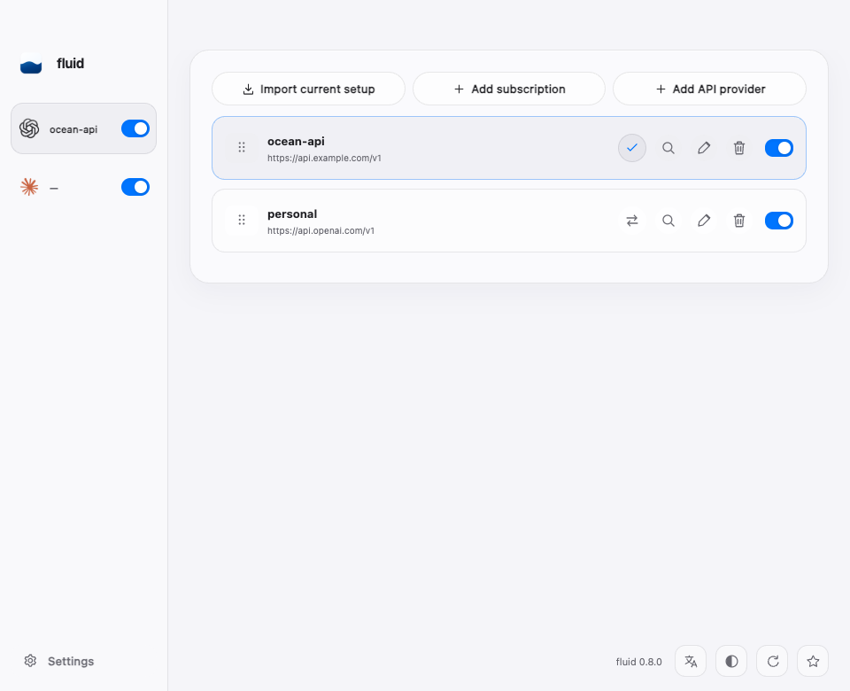

# Desktop & routing / 桌面与路由

## Start in three steps / 三步开始

1. [Install fluid](https://github.com/JasperRoc/fluid/releases) and open it. / 安装并打开 fluid。
2. Add a subscription, add an API, or import the current client configuration. API Base URL is optional. / 添加订阅、API，或导入当前配置；Base URL 可留空。
3. Start Codex or Claude normally. Use the tray or provider card to switch. / 照常启动客户端，通过托盘或服务商卡片切换。

The left rail selects Codex or Claude; its switch controls routing for that client. Drag a card’s grip to reorder fallbacks. Edit changes alias, URL and key; the toggle excludes a provider from routing without deleting it. / 左侧选择客户端并独立开启路由；拖动把手调整备用顺序，编辑按钮修改别名、地址与密钥，开关控制参与路由。

## What switches / 切换规则

The next request uses your selection. Before output starts, explicit quota, expired authentication, unavailable model or image capability errors can try the next enabled provider. Transient network and overload errors follow the client’s retry policy. Accepted output and tool events are never replayed. Switching does not create a subscription or grant model access. / 后续请求使用所选服务商；明确的额度、认证、模型或图片能力错误可在输出前尝试备用方式。临时网络、过载错误沿用客户端重试；已接收的输出和工具事件不重放。

The local gateway listens on `127.0.0.1:18345`. Internet proxy settings are read automatically; this is separate from the local route. Models remain selected in Codex or Claude. Claude APIs may need model-family mapping in the provider editor. / 本地网关默认端口为 `18345`，与自动读取的外网代理分开；模型仍在原客户端选择，Claude 第三方模型可在编辑窗口配置映射。

## macOS first launch / 首次打开

Current previews use ad hoc signatures and are not Apple-notarized. Download from the repository, then use **System Settings → Privacy & Security → Open Anyway** after the first block. / 当前预览版采用临时签名、未公证，首次被拦截后在「系统设置 → 隐私与安全性 → 仍要打开」允许。

[Apple’s explanation](https://support.apple.com/en-us/102445) · [Publisher signing setup](development.md#macos-signing)

## Quit & uninstall / 退出与卸载

Closing the window keeps routing in the tray. Quit restores the client connection. Choose start-at-login in Settings. Uninstall from the operating system or fluid Settings; restore client configuration before deleting data. / 关闭窗口保留后台路由，退出则恢复客户端连接；设置里可选择开机启动。通过系统或软件设置卸载，先恢复连接再删除数据。

Data lives in `~/.fluid`, isolated from native client sessions. Credentials remain local and are protected by file permissions. / 数据保存在 `~/.fluid`，与客户端原生会话分离；凭据由本地文件权限保护。
