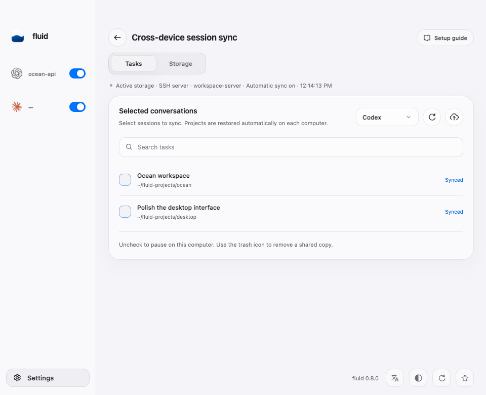

# Sessions across devices



**Choose a session once. Continue it on another computer.**

1. Open **Settings → Cross-device session sync**. Choose **SSH** or **WebDAV**; they are alternatives, not two simultaneous stores.
2. Configure the same storage and encryption passphrase on both computers.
3. Choose **Codex** or **Claude Code**, then select sessions. fluid restores projects automatically; wait for **Synced**, then open the conversation in its client.

## SSH: use your existing server

First verify your connection in a terminal:

```bash
ssh your-server
```

In fluid, enter `your-server` (an SSH alias) or `user@hostname`, plus a shared encryption passphrase of at least 12 characters. Click **Verify and save** on each computer. The same server account stores encrypted files in `~/.fluid-sync/` using SFTP. No database, Docker or server-side application is needed. SSH keys/agent and server identity must already work.

## WebDAV: enter the storage account

| Field | Nutstore example |
| --- | --- |
| URL | `https://dav.jianguoyun.com/dav` |
| Username | Login email |
| Password | App password from Security → Third-party applications |
| Encryption | Same private passphrase on every device |

fluid appends `/fluid/` and creates missing folders automatically. Paste a full library URL to use that folder. Zotero WebDAV users can reuse the service account; fluid keeps a separate folder. Zotero Storage itself is not a WebDAV service.

## What follows you

Conversation history, Git commit/state, staged and unstaged changes, and eligible untracked project files. Ordinary folders also work. Claude subagent transcripts are included. Each client uses its destination machine’s own provider configuration.

- **Uncheck:** pause this device; remote copy remains.
- **Trash:** remove shared copies; local sessions remain.
- **Conflict:** choose local or remote explicitly; neither side is silently overwritten.
- **Open task:** incoming changes wait until the destination releases it.

Background checks run every 30 seconds while fluid is running and pause during sleep. Verified encrypted index files are cached; remote listings still detect new versions and deletions. First transfer depends on project size and network speed.

## Limits & fixes

Git is required. Git submodules and complete execution environments are not migrated. Limits: 128 MiB Git/history/working data per category, 32 MiB per attachment or untracked file, 256 MiB encrypted package. Ignored files stay local; avoid committing secrets. Projects restore under `~/fluid-projects` unless already mapped.

| Problem | Check |
| --- | --- |
| 401 / 403 | App password, account name, write permissions and service quota |
| SSH failure | Terminal connection, host key and SFTP permission |
| Session not listed in Codex | Open the restored project directory; reload Codex |
| Waiting for write | Close the target session and retry |

[简体中文](task-sync.zh-CN.md)
