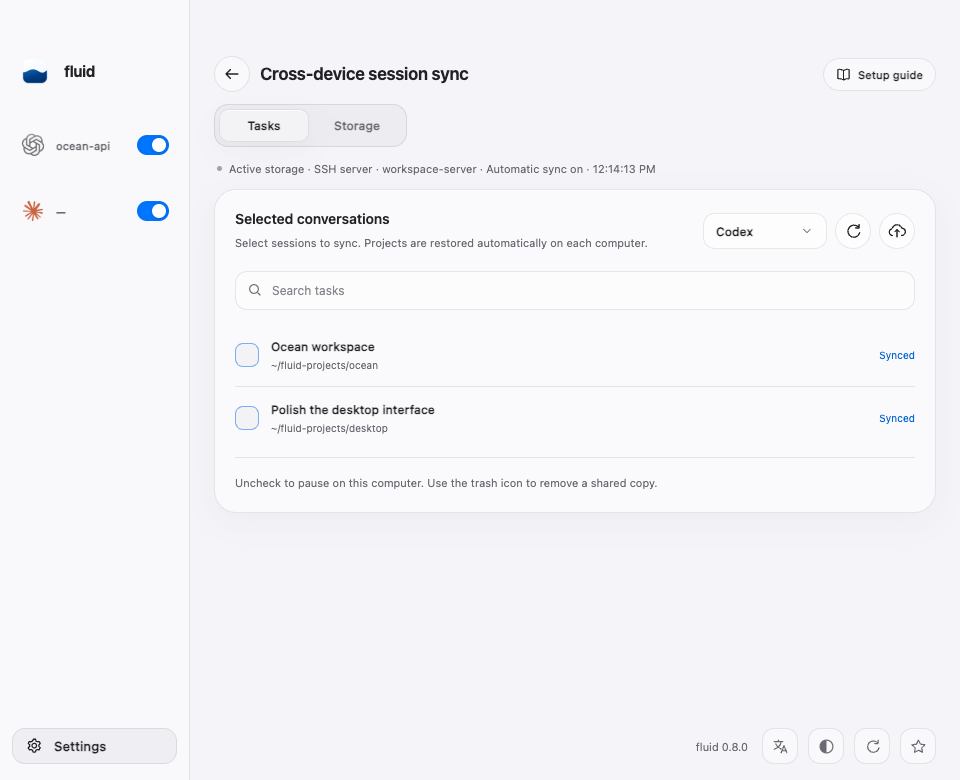

# 会话跨设备同步



**勾选一次，换台电脑接着聊。**

1. 打开 **设置 → session 跨设备同步**，选择 **SSH 服务器**或 **WebDAV**。两者二选一，保存后以新存储为准。
2. 两台电脑配置同一存储、同一个共享加密口令。
3. 选择 **Codex／Claude Code**，勾选会话。软件自动恢复项目；等状态显示「已同步」，在原客户端打开即可。

## SSH：已有服务器就够了

先在终端确认连接成功：

```bash
ssh your-server
```

在 fluid 填写 `your-server`（SSH 别名）或 `user@hostname`，再填至少 12 字符的共享加密口令，点击「验证并保存」。另一台电脑连接相同的服务器账号。加密文件通过 SFTP 存入 `~/.fluid-sync/`，无需部署数据库、Docker 或服务端程序。SSH 密钥、代理与主机身份校验需先配置好。

## WebDAV：填上存储账号即可

| 配置项 | 坚果云示例 |
| --- | --- |
| 地址 | `https://dav.jianguoyun.com/dav` |
| 用户名 | 登录邮箱 |
| 密码 | 安全选项 → 第三方应用管理中的应用密码 |
| 加密口令 | 每台设备填写相同的私密口令 |

软件自动补全 `/fluid/` 并创建缺失目录；也可粘贴完整存储地址。使用 Zotero WebDAV 时可复用同一存储账号，fluid 使用独立目录；Zotero Storage 本身不是 WebDAV 服务。

## 同步什么

会话历史、Git 提交与状态、暂存和未暂存改动、符合条件的未跟踪项目文件。普通文件夹也能同步，Claude 子代理历史会一并迁移；接收端始终使用本机服务商配置。

- **取消勾选：**只暂停这台电脑，远端副本保留。
- **垃圾桶：**删除共享副本，本机会话保留。
- **冲突：**手动选择本地或远端，不静默覆盖。
- **会话被占用：**等待目标客户端释放后再写入。

fluid 运行时每 30 秒后台检查一次，休眠时暂停。加密索引缓存减少重启后的下载，每轮仍检查远端新增、删除与冲突。首次传输速度取决于项目大小和网络。

## 限制与排查

需要安装 Git，不迁移子模块和完整执行环境。Git 历史、会话历史、工作区数据每类上限 128 MiB；单个附件或未跟踪文件上限 32 MiB；加密包上限 256 MiB。忽略文件留在本机，避免将密钥提交进 Git。新项目默认恢复到 `~/fluid-projects`，已有映射继续使用。

| 问题 | 检查 |
| --- | --- |
| 401／403 | 应用密码、账号、写入权限、服务额度 |
| SSH 连接失败 | 终端连接、主机密钥、SFTP 权限 |
| Codex 找不到会话 | 打开恢复后的项目目录，重新加载客户端 |
| 等待写入 | 关闭目标会话后重试 |

[English](task-sync.md)
