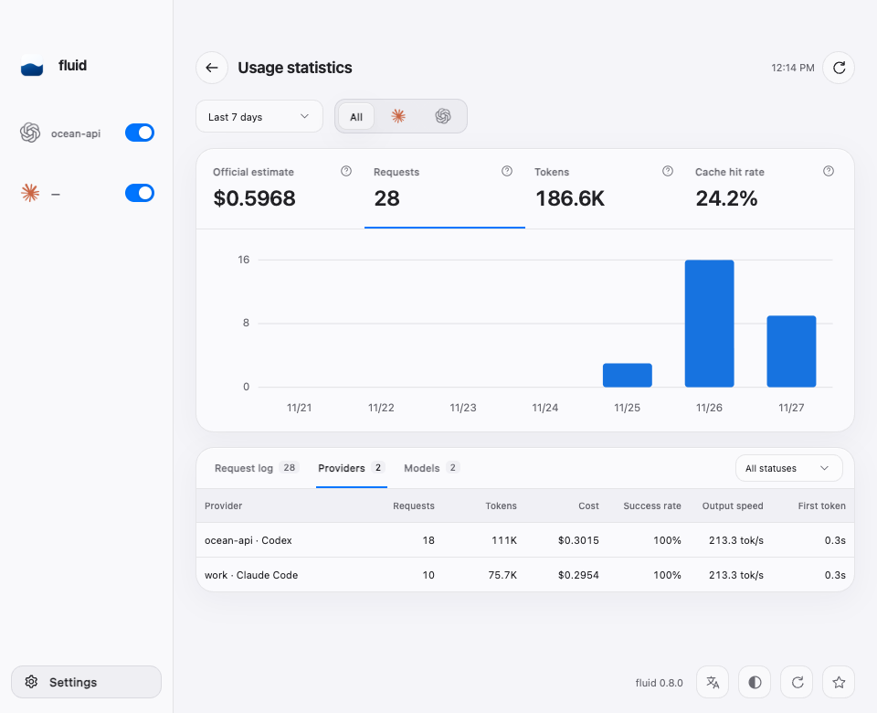

# Usage / 用量统计

Open **Settings → Usage statistics**. Choose a period and client, then view requests, providers or models. / 打开「设置 → 用量统计」，选择时间和客户端，按请求、服务商或模型查看。

| Metric / 指标 | Meaning / 含义 |
| --- | --- |
| Requests / 请求 | Recorded gateway requests; cancelled calls are separate / 网关记录的请求，取消单独统计 |
| Tokens | Input + output; reported cache components shown separately / 输入与输出，缓存分项单列 |
| Cache hit / 缓存命中 | Cached input ÷ input with cache reporting / 缓存输入占已报告缓存信息的输入比例 |
| Cost / 费用 | Official reference token rates × reported usage / 官方参考单价乘以实际报告用量 |
| Speed / 速度 | Output tokens per second / 每秒输出 Token |
| First token / 首 Token | Time before initial output / 首次输出耗时 |

`K` and `M` mean thousand and million tokens; `$` is US dollars. Models without verified pricing, image jobs and subscription calls show no invented monetary cost. Third-party pricing can differ from official reference rates; this is not a bill. Missing usage stays unknown. / `K`、`M` 表示千和百万 Token，`$` 为美元；无已验证价格、图片请求和订阅调用不虚构费用。第三方实际计价可能不同，统计不是账单；缺失用量保持未知。

Logs stay local in `~/.fluid/usage`. No prompt or response text is recorded by the usage monitor. / 日志保存在本机，不记录对话正文。
